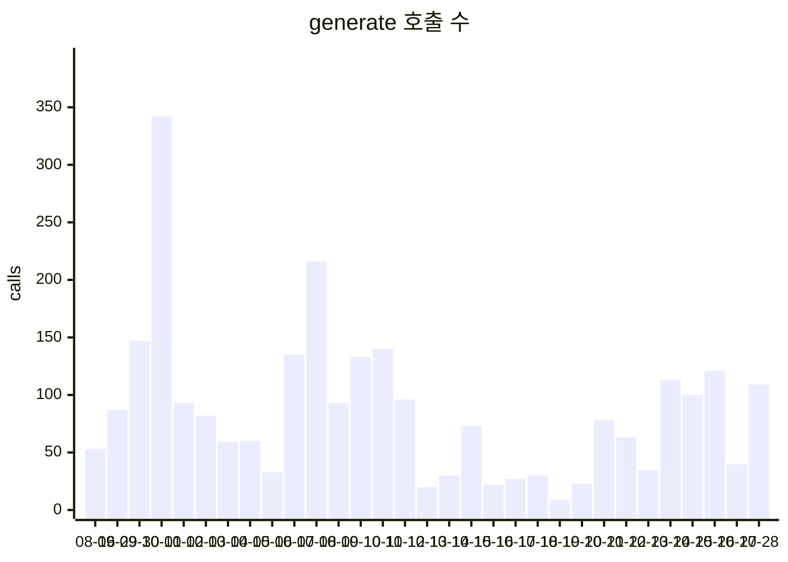
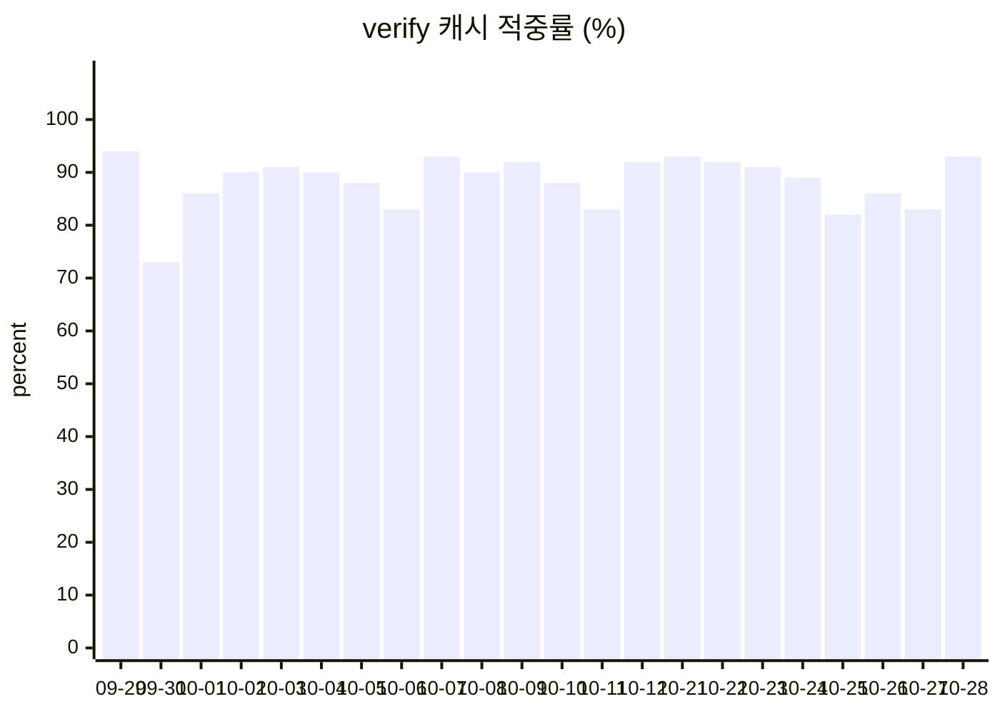

# 토큰 사용량

`GET /api/admin/audit/token-usage` 롤업을 그대로 옮긴 것이다. **원본은 `token_usage` 테이블**이고
이 파일은 사본이라 언제든 아래 명령으로 다시 만든다. 손으로 고치지 말 것.

```bash
~/bin/pinq-quiz-fetch.sh tokens 30 | python scripts/build-token-page.py -o docs/data/token-usage.md
```

## 날짜 x kind

| 날짜 | kind | 호출 | prompt | completion | cache_write | cache_read | total |
|---|---|---:|---:|---:|---:|---:|---:|
| 2026-08-16 ⚠️ | generate | 53 | 321,946 | 11,935 | 0 | 0 | 333,881 |
| 2026-08-16 ⚠️ | verify | 10 | 37,214 | 1,026 | 5,596 | 22,384 | 66,220 |
| 2026-09-29 | generate | 87 | 531,970 | 19,154 | 0 | 0 | 551,124 |
| 2026-09-29 | verify | 17 | 64,566 | 2,000 | 2,798 | 44,768 | 114,132 |
| 2026-09-30 | generate | 147 | 876,389 | 21,820 | 0 | 0 | 898,209 |
| 2026-09-30 | verify | 11 | 41,289 | 868 | 8,394 | 22,384 | 72,935 |
| 2026-10-01 | generate | 342 | 2,022,768 | 63,349 | 0 | 0 | 2,086,117 |
| 2026-10-01 | verify | 28 | 103,051 | 3,647 | 11,192 | 67,152 | 185,042 |
| 2026-10-02 | generate | 93 | 565,577 | 22,625 | 0 | 0 | 588,202 |
| 2026-10-02 | verify | 20 | 76,066 | 2,467 | 5,596 | 50,364 | 134,493 |
| 2026-10-03 | generate | 82 | 498,447 | 16,575 | 0 | 0 | 515,022 |
| 2026-10-03 | verify | 11 | 41,265 | 1,359 | 2,798 | 27,980 | 73,402 |
| 2026-10-04 | generate | 59 | 349,822 | 8,696 | 0 | 0 | 358,518 |
| 2026-10-04 | verify | 10 | 37,531 | 886 | 2,798 | 25,182 | 66,397 |
| 2026-10-05 | generate | 60 | 367,404 | 11,793 | 0 | 0 | 379,197 |
| 2026-10-05 | verify | 8 | 30,658 | 1,051 | 2,798 | 19,586 | 54,093 |
| 2026-10-06 | generate | 33 | 203,828 | 8,205 | 0 | 0 | 212,033 |
| 2026-10-06 | verify | 6 | 21,961 | 398 | 2,798 | 13,990 | 39,147 |
| 2026-10-07 | generate | 135 | 809,915 | 27,973 | 0 | 0 | 837,888 |
| 2026-10-07 | verify | 15 | 54,777 | 1,727 | 2,798 | 39,172 | 98,474 |
| 2026-10-08 | generate | 216 | 1,296,123 | 41,452 | 0 | 0 | 1,337,575 |
| 2026-10-08 | verify | 20 | 75,348 | 2,451 | 5,596 | 50,364 | 133,759 |
| 2026-10-09 | generate | 93 | 567,512 | 17,265 | 0 | 0 | 584,777 |
| 2026-10-09 | verify | 12 | 46,432 | 1,253 | 2,798 | 30,778 | 81,261 |
| 2026-10-10 | generate | 133 | 806,136 | 24,513 | 0 | 0 | 830,649 |
| 2026-10-10 | verify | 17 | 63,971 | 1,963 | 5,596 | 41,970 | 113,500 |
| 2026-10-11 | generate | 140 | 848,977 | 31,375 | 0 | 0 | 880,352 |
| 2026-10-11 | verify | 18 | 68,623 | 2,237 | 8,394 | 41,970 | 121,224 |
| 2026-10-12 | generate | 96 | 581,188 | 20,811 | 0 | 0 | 601,999 |
| 2026-10-12 | verify | 12 | 47,118 | 849 | 2,798 | 30,778 | 81,543 |
| 2026-10-13 | generate | 20 | 125,074 | 4,930 | 0 | 0 | 130,004 |
| 2026-10-14 | generate | 30 | 185,882 | 6,244 | 0 | 0 | 192,126 |
| 2026-10-15 | generate | 73 | 446,876 | 18,910 | 0 | 0 | 465,786 |
| 2026-10-16 | generate | 22 | 135,175 | 4,224 | 0 | 0 | 139,399 |
| 2026-10-17 | generate | 27 | 165,502 | 6,661 | 0 | 0 | 172,163 |
| 2026-10-18 | generate | 30 | 181,124 | 6,718 | 0 | 0 | 187,842 |
| 2026-10-19 | generate | 9 | 58,257 | 3,506 | 0 | 0 | 61,763 |
| 2026-10-20 | generate | 23 | 137,997 | 4,492 | 0 | 0 | 142,489 |
| 2026-10-21 | generate | 78 | 485,529 | 19,615 | 0 | 0 | 505,144 |
| 2026-10-21 | verify | 15 | 56,360 | 1,478 | 2,798 | 39,172 | 99,808 |
| 2026-10-22 | generate | 63 | 389,767 | 19,736 | 0 | 0 | 409,503 |
| 2026-10-22 | verify | 13 | 49,708 | 1,535 | 2,798 | 33,576 | 87,617 |
| 2026-10-23 | generate | 35 | 216,901 | 9,052 | 0 | 0 | 225,953 |
| 2026-10-23 | verify | 11 | 42,864 | 902 | 2,798 | 27,980 | 74,544 |
| 2026-10-24 | generate | 113 | 691,342 | 23,202 | 0 | 0 | 714,544 |
| 2026-10-24 | verify | 18 | 69,907 | 1,700 | 5,596 | 44,768 | 121,971 |
| 2026-10-25 | generate | 100 | 610,592 | 17,443 | 0 | 0 | 628,035 |
| 2026-10-25 | verify | 11 | 40,799 | 1,035 | 5,596 | 25,182 | 72,612 |
| 2026-10-26 | generate | 121 | 739,682 | 27,320 | 0 | 0 | 767,002 |
| 2026-10-26 | verify | 14 | 51,691 | 1,686 | 5,596 | 33,576 | 92,549 |
| 2026-10-27 | generate | 40 | 246,610 | 9,708 | 0 | 0 | 256,318 |
| 2026-10-27 | verify | 6 | 22,166 | 444 | 2,798 | 13,990 | 39,398 |
| 2026-10-28 | generate | 109 | 660,866 | 20,757 | 0 | 0 | 681,623 |
| 2026-10-28 | verify | 15 | 56,917 | 1,518 | 2,798 | 39,172 | 100,405 |

⚠️ 표시한 행은 **테이블 이전 구간**이다. `token_usage` 는 2026-08-17 배포부터 차므로 8/16 은
DB 에 없고 검수 로그의 수기 합계를 옮긴 것이다. 세는 법이 DB 행과 같은지는 보장되지 않는다.

## 캐시 성과

**적중률로 본다. `prompt` 합의 감소를 절감으로 읽지 않는다** — 캐시가 먹으면 당연히 줄어드는
값이라 그렇게 읽으면 캐시가 잘 들을수록 "비용이 늘었다"와 "줄었다"를 구분할 수 없다.

`generate` 는 캐시 대상이 아니라 제외했다(전부 `cache_write=0 cache_read=0`, 설계대로).
`회차 추정` 은 `cache_write / 2798` — 캐시 TTL 5분이라 회차마다 첫 건이 새로 쓴다.
정기·백필 회차 수와 맞는지 보는 자리다.

| 날짜 | verify 호출 | 캐시 적중 | 적중률 | cache_write | 회차 추정 |
|---|---:|---:|---:|---:|---:|
| 2026-08-16 ⚠️ | 10 | — | — | 5,596 | 2 |
| 2026-09-29 | 17 | 16 | 94% | 2,798 | 1 |
| 2026-09-30 | 11 | 8 | 73% | 8,394 | 3 |
| 2026-10-01 | 28 | 24 | 86% | 11,192 | 4 |
| 2026-10-02 | 20 | 18 | 90% | 5,596 | 2 |
| 2026-10-03 | 11 | 10 | 91% | 2,798 | 1 |
| 2026-10-04 | 10 | 9 | 90% | 2,798 | 1 |
| 2026-10-05 | 8 | 7 | 88% | 2,798 | 1 |
| 2026-10-06 | 6 | 5 | 83% | 2,798 | 1 |
| 2026-10-07 | 15 | 14 | 93% | 2,798 | 1 |
| 2026-10-08 | 20 | 18 | 90% | 5,596 | 2 |
| 2026-10-09 | 12 | 11 | 92% | 2,798 | 1 |
| 2026-10-10 | 17 | 15 | 88% | 5,596 | 2 |
| 2026-10-11 | 18 | 15 | 83% | 8,394 | 3 |
| 2026-10-12 | 12 | 11 | 92% | 2,798 | 1 |
| 2026-10-21 | 15 | 14 | 93% | 2,798 | 1 |
| 2026-10-22 | 13 | 12 | 92% | 2,798 | 1 |
| 2026-10-23 | 11 | 10 | 91% | 2,798 | 1 |
| 2026-10-24 | 18 | 16 | 89% | 5,596 | 2 |
| 2026-10-25 | 11 | 9 | 82% | 5,596 | 2 |
| 2026-10-26 | 14 | 12 | 86% | 5,596 | 2 |
| 2026-10-27 | 6 | 5 | 83% | 2,798 | 1 |
| 2026-10-28 | 15 | 14 | 93% | 2,798 | 1 |

## 추이



⚠️ 호출 수는 **낭비의 독립 지표가 아니다.** 그날 생성 시도 수와 함께 움직인다 —
손실 집계([loss-stats.html](loss-stats.html))의 시도 수와 나란히 볼 것.


